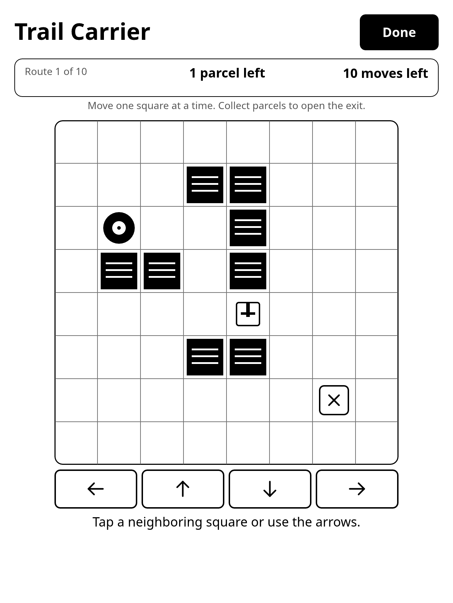
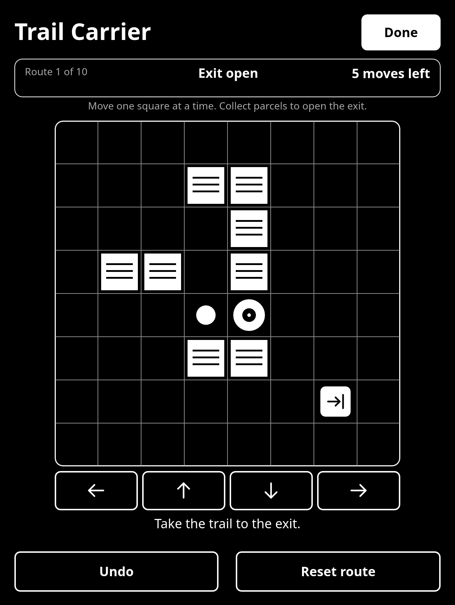
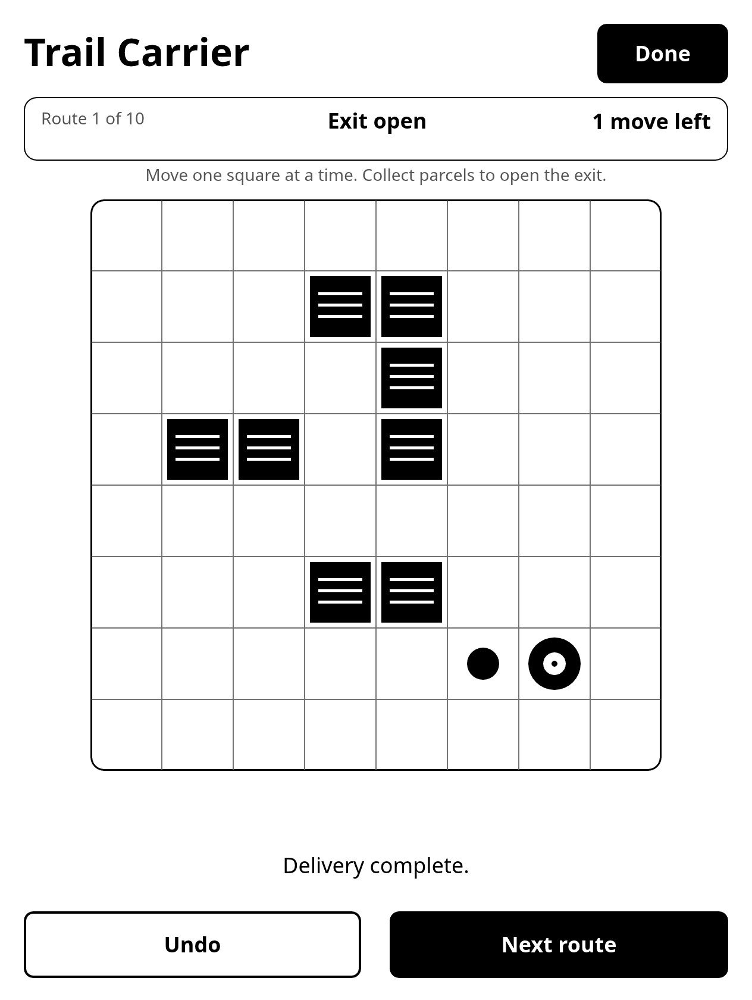

<div align="center">


# kindle-primitive-trailcarrier

[](https://github.com/PrimitiveOS/kindle-primitive-trailcarrier/releases)

[**Download**](https://github.com/PrimitiveOS/kindle-primitive-trailcarrier/releases/latest) · [**Install guide**](INSTALL.md) · [**Changelog**](CHANGELOG.md)

</div>

---

## Quick start

After setting up PrimitiveOS, open **Store** from Primitive Launcher. Choose **kindle-primitive-trailcarrier** under **Apps**,
tap **Get**, and open it from the Launcher grid. The [install guide](INSTALL.md) also covers the standalone USB package.

## Screenshots

<table>
<tr>
<td align="center"><br><sub>The first route with a courier, parcel, walls and locked exit</sub></td>
<td align="center"><br><sub>A longer trail and an open exit in dark mode</sub></td>
<td align="center"><br><sub>A completed delivery with one move left</sub></td>
</tr>
</table>

Desktop simulation captures at 1264 × 1680 pixels.

## Develop locally

Keep the Tools and Launcher checkouts next to this repository.

```sh
cargo test --offline --locked --workspace
cargo run --offline --locked -p trailcarrier-desktop
```

The desktop target exercises the touch controls and writes previews to `build/previews/`.

## Status

| Device | Status |
|---|---|
| Kindle Oasis 3 (1264 × 1680, firmware 5.18.2) | Not yet tested on hardware |

## Downloads

Not yet listed in Store.

## Documentation

[Install guide](INSTALL.md) · [Changelog](CHANGELOG.md)

## Licence

Copyright (C) 2026 Doan Nguyen.

Code is licensed under [PolyForm Noncommercial 1.0.0](LICENSE). The documentation and original art are
licensed under [CC BY-NC-SA 4.0](LICENSE-DOCS).
